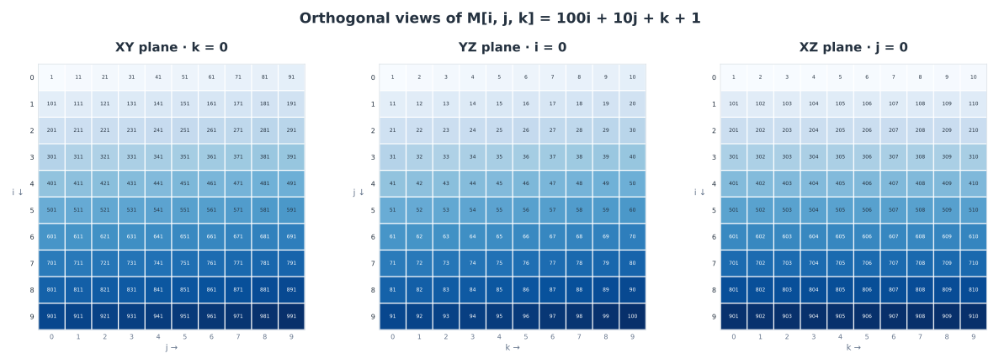
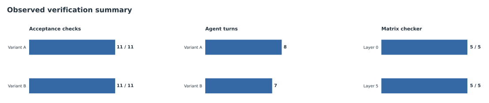

# MiniAgent · Autonomous Coding and Matrix Verification

**Lab 2 | Python agent orchestration, structured tool use, and execution feedback**

A compact coding agent that inspects a workspace, proposes Python edits, runs a checker, and iterates on tool results. It uses a bounded action loop, a common model-provider interface, argument validation, a write-approval gate, and a JSONL audit trail.

**Python** · **JSON tool actions** · **Ollama** · **Online DeepSeek API** · **Human approval** · **JSONL logging**

> **Documentation-only portfolio.** This repository shows system design, derived matrix visualizations, and observed evaluation results. It does **not** publish the private submission, teacher fixtures, executable agent, API credentials, or raw execution logs. Figures reflect completed runs; there is no public CI/test harness here.

## What the agent does

1. Reads the task definition and acceptance checker using `read_file`.
2. Generates a Python implementation using `write_file`, subject to a human approval decision.
3. Executes the checker using `run_bash` and receives its stdout, stderr, and exit status.
4. Appends the result to the next model request, logs the turn, and continues until `finish` or the maximum step count.

### Workflow


[Architecture and state flow →](docs/architecture.md) · [Tools and provider interface →](docs/components.md)

## Task: a 10 × 10 × 10 integer matrix

The generated Python module constructs a 3D matrix where each cell follows:

$$M[i,j,k] = 100i + 10j + k + 1,\qquad i,j,k\in\{0,1,\ldots,9\}$$

This produces integers **1–1000**, with three orthogonal, **computed** 10×10 views: `XY (k=0)`, `YZ (i=0)` and `XZ (j=0)`.



*Cells display exact matrix values. Shade intensity is scaled within each panel to make its pattern legible; the three panels do not share one color scale.*

## Verification results

The completed agent was evaluated with two independent variants of the project acceptance checker. Both passed **all 11 checks**, including genuine tool use, logging, normal completion, human write approval, matrix correctness, and layer-change resilience.



| Verification item | Variant A | Variant B |
|---|:---:|:---:|
| Acceptance checks | **11/11** | **11/11** |
| Agent turns recorded | **8** | **7** |
| Actual `read_file` / `write_file` / `run_bash` use | Passed | Passed |
| Approved write recorded in JSONL | Passed | Passed |
| Correct matrix & changed-layer check | Passed | Passed |

An independent matrix run also passed **5/5 tests at layer 0** and **5/5 tests at layer 5**.

[Evaluation notes →](docs/results.md)

## Feedback ablation

A separate version of the agent was run with the step that adds tool results back into the conversation disabled. All **12** turns called `read_file("README.md")`; the model did not progress to writing or running tests, and the step budget was exhausted.


The observation supports the central design requirement: **tool execution alone is insufficient; its result must be included in subsequent model context**. The test is a single observed comparison, not a claim that every run without feedback fails.

[Experiment setup and interpretation →](docs/feedback-experiment.md)

## Repository contents

```text
miniagent-lab2-showcase/
├── README.md                   Project overview
├── docs/
│   ├── architecture.md         Agent loop and decision flow
│   ├── components.md           CLI, providers, tools, audit, approval
│   ├── results.md              Verification tables and caveats
│   └── feedback-experiment.md  Controlled feedback-removal test
├── assets/                     Vector diagrams and data charts (SVG)
├── data/metrics.json           Non-sensitive, observed result counts
├── diagrams/agent-workflow.dot Editable Graphviz diagram source
├── scripts/render_charts.py    Rebuild the three analytical charts
├── requirements-viz.txt        Visualization-only dependency
├── GITHUB_DESCRIPTION.txt      Copy-paste GitHub description/topics
├── SECURITY.md                 Public release safeguards
└── .gitignore                  Exclusions for secrets and lab artifacts
```

The SVG charts can be read directly on GitHub. Their numeric inputs live in [`data/metrics.json`](data/metrics.json), and the figure-generation script is included for reproducibility. This script only produces graphics; it **does not run the agent**.

## Scope

**Included:** architectural design, quantitative evidence, a representative action protocol, and original data visualizations.  
**Not included:** personal details, identifiers, private file paths, API keys, live credentials, full submission code, grader files, or raw `agent.log` data.

See [SECURITY.md](SECURITY.md) before extending or sharing this showcase.
