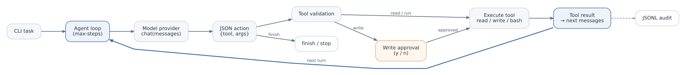
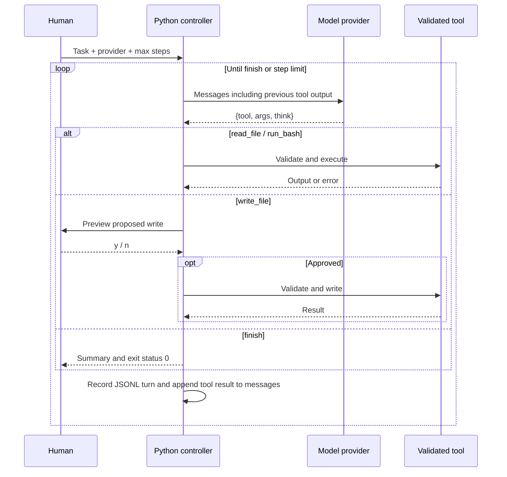

# Architecture and Control Loop

[← Repository overview](../README.md)

MiniAgent is a host-driven coding agent. The **model proposes one action**; a Python controller validates it and decides whether and how it may execute.

## Main components

| Component | Role | Boundary |
|---|---|---|
| CLI | Receives task, provider, step limit | Invalid arguments terminate predictably |
| Provider interface | `chat(messages)` over Demo, Ollama, or online backend | Returns a model response only |
| JSON parser | Parses one tool request per turn | Malformed JSON returned as feedback; one retry |
| Tool registry | Defines tools with argument schemas | Rejects unknown tools and invalid arguments |
| Tool runner | Reads files, writes source, runs commands | Explicitly bounded commands; errors returned as text |
| Approval gate | Shows target path and first ten proposed lines | Human may reject writes before execution |
| JSONL logger | Records every action and status | One record per turn with approval status |

## One action at a time

## Feedback as state transfer

An external tool's output does not automatically become model memory. The controller sends the prior tool result within the next `messages` collection. This allows the model to read a file once, learn its contents, run a test, and react to the test output.

The [feedback-removal experiment](feedback-experiment.md) demonstrates one observed failure mode when this step is removed.

## Exit and error rules

- The `finish` tool ends an ordinary run (`exit 0`).
- Reaching `--max-steps` ends it without a natural finish (`exit 2`).
- Unknown tools, invalid arguments, and command failures become feedback rather than silent success.
- `write_file` is not executed when interactive approval is denied.

This is a bounded workflow, **not** an agent with unrestricted computer access.
