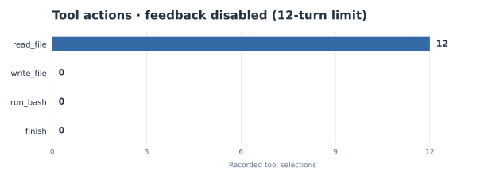

# Feedback Removal Experiment

[← Repository overview](../README.md)

## Question

What changes if the controller **executes tools but does not append their outcomes to the next model messages**?

## Experiment

Two isolated copies of the completed MiniAgent were evaluated on the same matrix task:

- **Baseline:** normal loop with tool-result messages enabled.
- **Ablation:** the `messages.append(...)` block carrying execution feedback was disabled in an experimental copy, while the original agent remained unchanged.

The task used a 12-turn maximum. The ablation run's JSONL records were examined afterward to identify which tools were selected.

## Observed behavior

| Observation | Baseline | Feedback disabled |
|---|---|---|
| Generated matrix file | Yes | No |
| Independent matrix checker | 5/5 passed | Not reached |
| Termination | Natural `finish` | Step limit exhausted (12) |
| Tool sequence | Progressed through coding and verification | 12 `read_file("README.md")` calls |

The 12 read operations individually succeeded, but their results were not delivered to the model in later turns. In that observed run, the agent kept requesting the same initial read and never advanced to writing or testing.

## Interpretation

Tool output must be fed back through `messages` for the controller to preserve external execution state between stateless model requests. This ablation provides direct evidence of the failure mode in the tested setup, **not** proof that every agent/model run without feedback always fails.

The original functioning implementation and all private data remain out of this public showcase.
